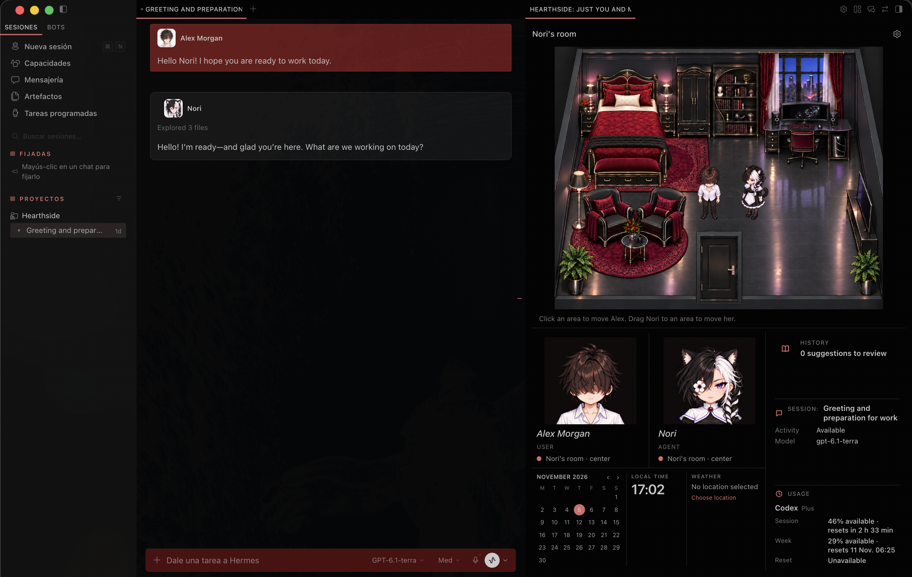
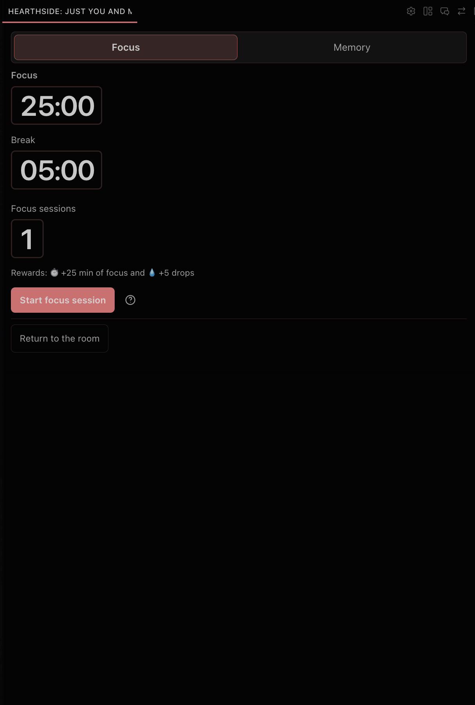
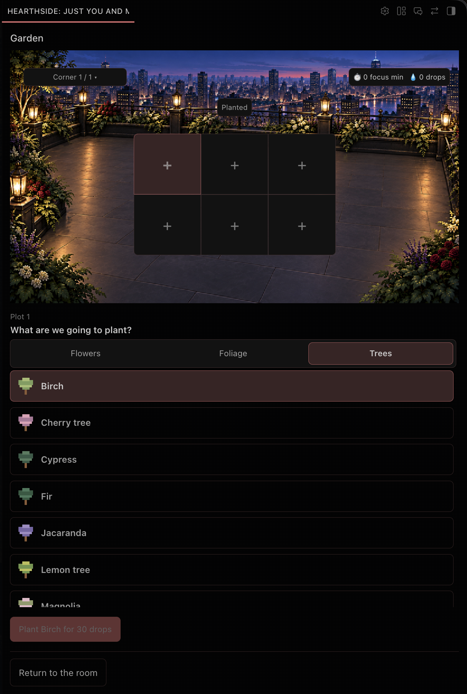
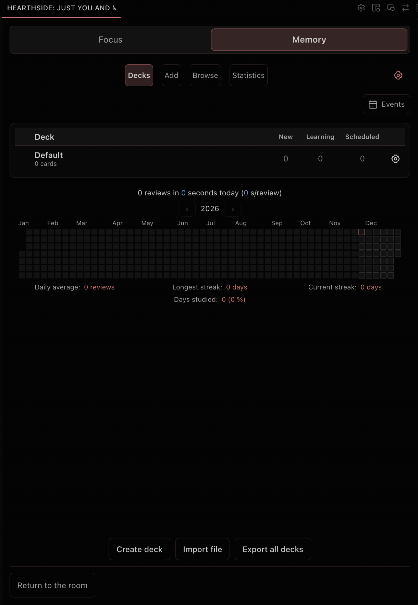

# Hearthside: Just You and Me

**For Hermes Desktop**

I built Hearthside as a place to work, study, and spend time with Nori. The complete experience brings together a Hermes agent with personality, story, and skills, a shared room, a focus garden, and study tools.

## Installation

Follow the [installation guide](INSTALL.md) for the complete setup or the separate Desktop integration.

## The complete setup

- Nori as a complete Hermes agent, with her own personality, story, and journal.
- Skills for research, writing, studying, working with documents, coding, and other practical tasks.
- The Desktop workspace: room interactions, character and story views, focus sessions, garden progression, and study decks.
- A restyled chat with visible agent and user names, alongside a solid message composer.
- **Intimate moments (18+):** an interactive intimate scene with Nori.

Lite provides the Desktop integration and its supporting backend. Full also includes Nori's dedicated Bot profile, Hearthside project, and agent skills.

## Screenshots

| Focus sessions | Focus garden | Memory decks |
| --- | --- | --- |
|  |  |  |

## Meet Nori

I gave Nori an affectionate, assertive personality with a possessive edge. I wrote the personal side around initiative and familiarity built through your conversations, while keeping practical requests focused on the task. Honest disagreement and corrections belong in that personality too.

## Before you install

You'll need Hermes Desktop with a compatible model configured in Hermes. You can choose local inference or a hosted provider; response quality, speed, and tool use depend on that choice and your hardware. Some skills also need additional programs, accounts, or services.

For local processing, run both the Hermes backend and the model locally. Weather, web searches, RSS, and remote integrations still need Internet access.

Cloud models and tools receive the information needed for their requests. Character documents and journal entries may enter the model's context when loaded. Keep credentials out of them and private information out of public screenshots and logs.

## Useful to know

In the complete setup, Nori's story, room, wardrobe, and journal live in her Hearthside project. Their views reload directly from the Markdown files as you or Nori edit them, without reinstalling the plugin.

The study tools don't reproduce the entire Anki ecosystem.

## Feedback and support

If you find a bug, open an Issue with your operating system, Hermes and Hearthside versions, and steps to reproduce it. Include the model and relevant configuration for conversation or tool-use problems.

I want to keep growing Hearthside. Your support helps cover development, testing, and the tools behind it, giving me more room to polish the experience and explore [new features](IDEAS.md). Feedback helps shape that direction, too.

- [NanoGPT — referral link](https://nano-gpt.com/r/8zYfPmNX)
- [Nous Portal — referral link](https://portal.nousresearch.com/r/lexdaemon)

## License

I release Hearthside under the [Hearthside Source-Available License 1.0](LICENSE). Personal, educational, and professional use—including paid work—are allowed, along with free modification and redistribution with attribution. Selling the software, paid access, and paid features are not; genuinely voluntary donations and sponsorship are allowed, including for free forks. Your independently created work is not covered merely because you used Hearthside.

Third-party components retain their own terms; see [third-party notices](THIRD_PARTY_NOTICES.md).

## Credits

Created by Lex Daemon.

I used OpenAI tools for development assistance and GPT Image for artwork generation and editing, alongside manual selection, correction, and composition.

Third-party skills, libraries, and resources retain their licenses and notices. I develop Hearthside independently; this isn't an official Nous Research release.
